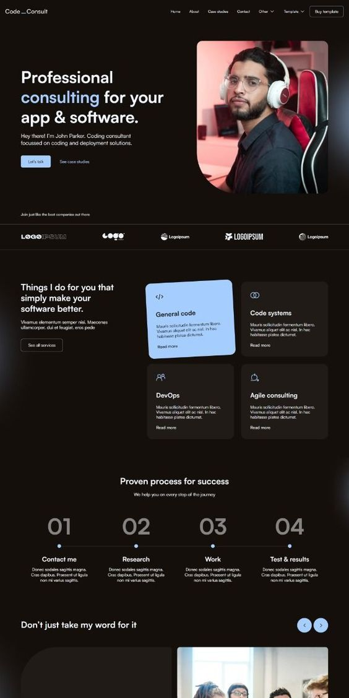
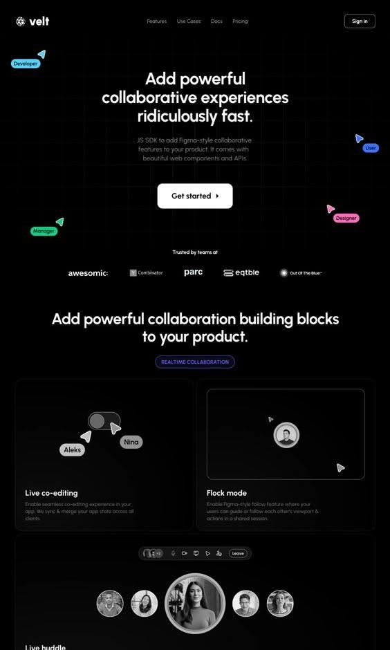
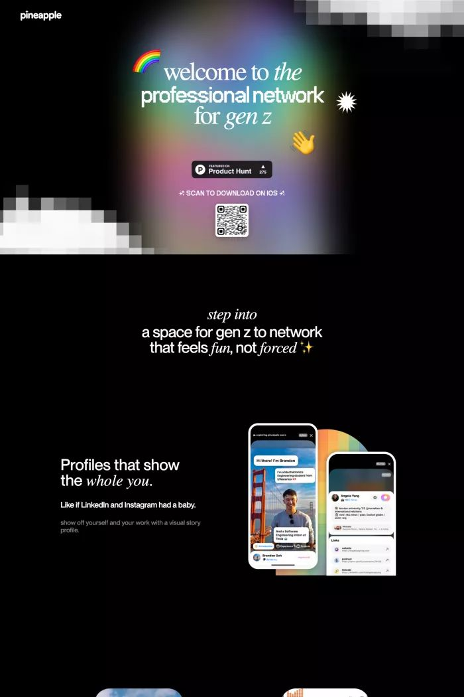
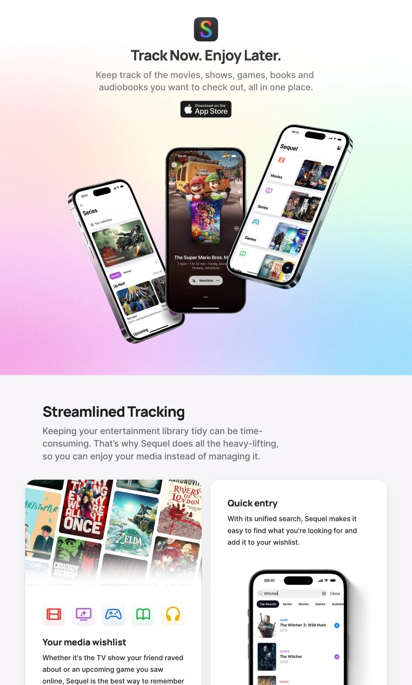
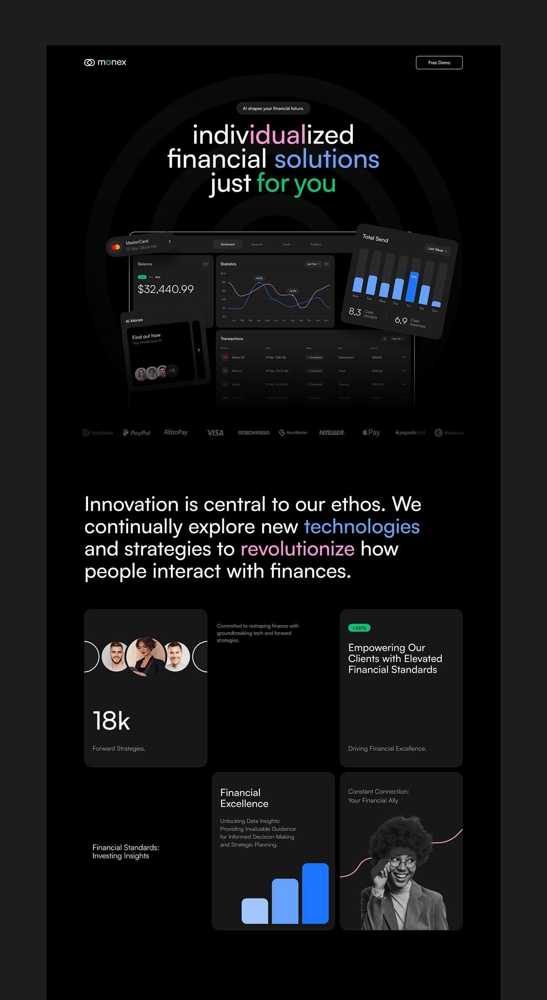
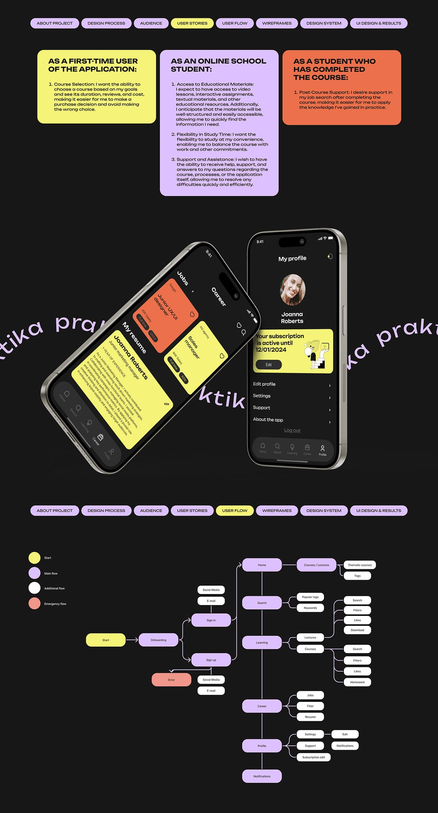

# 用户参考研究：用图形、界面与排版共同讲述项目

研究日期：2026-11-12。范围：用户提供的六张截图及 `editorial_demo.html`。

**状态：参考研究已整理；以下是观察与设计推导，不是已确认的页面设计，也不覆盖 DESIGN.md 或各页面 design.md。** 本轮没有修改页面代码、正式案例文案或既有设计值。具体构图需在对应页面的设计说明中形成可审核方案。

## 1. 研究依据与结论

用户表达的偏好：页面具有设计感，图形与文字结合；现有页面尤其项目详情显得普通、混乱。随后明确要求先研究参考的设计理念，再修改。

六张截图已逐张查看。下文将可见构图与对它的解释分开记录。静态截图不能证明真实动效、交互、响应式行为、实际字体名称或精确 CSS 数值；没有访问或核实这些站点的线上版本。HTML 部分另以源码为依据，不把源码推断写成已完成的渲染观察。品牌名称按图中可辨识文字命名。

**核心归纳：这些参考将每段内容组织成可以观看的画面。文字提出观点，界面或图形提供可见对象，位置、大小、色彩与连接关系引导理解。**

它们有三种不同的图像任务：

| 图像任务 | 代表参考 | 读者得到什么 | 用在本作品集的条件 |
| --- | --- | --- | --- |
| 建立气质与记忆 | Pineapple 的字体、光色与符号；Code_Consult 的人物照片 | 这个产品或作者给人的第一印象 | 画面符合作者与项目特征，且不会冒充项目成果 |
| 展示产品与设计完成度 | Sequel 的手机组合；Monex 的界面拆层 | 做出来的东西是什么样，有哪些关键部分 | 使用本项目真实界面，选出明确的主角，保持素材一致 |
| 解释机制与关系 | Velt 的协作场景；第六张的结构图；HTML 的局部业务示意 | 如何工作、哪些对象相关、条件不同会怎样 | 图形准确编码已有事实，关键文字无需放大即可理解 |

同一张图可以兼任两种任务，但必须明确主要任务。封面构图可以侧重印象，关键判断的解释图必须能够被读懂。

## 2. 六张参考的逐图拆解

### 2.1 Code_Consult：规整网格中的局部变化

**可见组织：** 首屏左侧是服务主张与操作，右侧是面积较大的人像；后续从横向标识带进入左侧介绍、右侧四格服务，再切换成四个编号相连的流程。底色偏暖黑，浅蓝同时出现在关键词、按钮、被强调的服务卡和节点上。

**设计解释：** 首屏的人像提供人物识别；服务区用一张浅蓝、轻微旋转的卡片打破重复。变化发生在稳定网格内部，其他卡片维持安静。流程区把顺序交给数字、节点和横线，正文只补充说明。各段的构图不同，同时共享容器和颜色。

**迁移价值：** 可以学习“一处重点、一组稳定的陪衬”以及章节之间的布局切换。对比方案可以突出发生变化的一侧，其余部分维持相同尺度。

**局限：** 服务区本身仍以图标和文字为主，不能据此推导出“加上卡片就完成图形化”。人物照、合作标识和客户证明需要真实资料，不直接搬入本作品集。

### 2.2 Velt：把抽象功能压缩成一个可见场景

**可见组织：** 居中的首屏主张四周散布带身份标签的彩色指针；下方功能区将切换控件、指针、头像、视口框和通话头像组放大呈现，每个功能只展示少量对象。背景和边框较弱，图形成为画面的主要内容。

**设计解释：** 指针与身份标签直接体现多人同时存在；视口框与人物、指针的关系帮助说明跟随；头像组体现多人交流。页面将完整产品中的一个行为提取出来，控制画面中需要理解的对象数量。图形的位置关系承担解释，功能标题为画面命名。

**迁移价值：** 最适合借鉴到会员案例的账单匹配、办理进度、优惠校验。每张解释图聚焦一个判断，例如三笔同金额记录如何甄别、哪些事项已完成。完整原图放在附近供核对，关键区域在默认阅读状态下可见。

**局限：** 这种提炼适合解释机制，但不能代替真实界面证据。示意图与真实截图要清楚标识。截图中的彩色指针只证明静态构图，不能据此断言有鼠标跟随或实时动画。

### 2.3 Pineapple：让产品性格贯穿字体、符号和画面

**可见组织：** 黑底首屏中，衬线斜体、像素感字形、彩虹、手势和星形围绕主张组合；柔和彩色光区集中于首屏，边缘存在像素块。中段短句作为停顿，后面用左侧短文、右侧两张手机界面展示个人资料。

**设计解释：** 多种字体和网络文化符号与面向年轻人的职业社交主题呼应。首屏先建立性格，再交代产品；后续回到较安静的排版，维持文字可读性。表达性的元素集中出现，形成主题明确的一幅画面。

**迁移价值：** 学习从项目或作者特征中寻找视觉语言。会员卡、账单、权益、额度与处理状态本身就能成为本作品集的视觉材料。可以用简短观点在两段密集解释之间形成停顿。

**局限：** 彩虹、像素和手势的组合属于这份参考的产品性格。放入医疗业务系统案例之前，需要说明它如何帮助读者理解项目。图中手机画面也不足以说明背后的产品判断。

### 2.4 Sequel：封面展示整体，功能区靠近细节

**可见组织：** 浅色首屏上方为图标、标题和介绍，下方三部手机错位叠放，中央与两侧形成主次；柔和彩色底衬托产品。进入功能区后，采用较平稳的浅色底与两栏大面板，封面拼图、分类图标和搜索界面对应各自功能说明。

**设计解释：** 首屏用多种界面建立产品范围与完成度；后续缩小讲解范围，让一个功能对应一个可以辨认的界面区域。首屏的倾斜和叠放增加空间感，解释区域则优先展示内容。图像中彩色媒体素材与页面背景形成连续的视觉联系。

**迁移价值：** 区分“让人看见作品整体”和“让人看懂一个判断”的观看距离。会员封面可以组合完整工作台与关键操作局部；正文中的金额、时间和状态需要正向、足够大的展示。

**局限：** 倾斜与遮挡适合封面。需要核对账单和收费字段的图不能遮住依据。浅色参考同样得到用户认可，因此偏好不能简化成“详情必须全黑”。

### 2.5 Monex：把产品界面组织成有主次的整体

**可见组织：** 黑色首屏中，大标题在上，完整仪表盘在下；两块局部面板脱离主体、向前叠放。弱同心轮廓聚拢视线。后续大段宣言用少量彩色词强调，再进入错位排列的卡片、开放文字、人物和图表。

**设计解释：** 仪表盘是稳定的主物件，浮出的局部说明它包含什么。它们依靠遮挡、尺寸、旋转和位置形成深度。下方各模块仍共享列线和留白，错位发生在共同秩序里。前后贯穿的界面色彩帮助连接整体与局部。

**迁移价值：** 与桌面系统项目最接近的产品展示方式。可以从真实界面中提取承担关键判断的片段，用连接或对应标签说明来自哪里。主界面与局部之间要能追溯。

**局限：** 图中的统计、人物和标识属于参考画面，不能移植成作者成果。柱状图在这里主要帮助形成印象；本案例若使用数据图，仍要有真实数值、单位、时间范围和口径。不能为了画面丰满虚构趋势。

### 2.6 彩色案例页：把不同种类的设计成果分别呈现

**可见组织：** 黑底上方为重复出现的章节导航，当前项用黄色标识；用户故事由三块不同颜色、自然高度的文字面板呈现。中间用大幅手机组合展示设计成果，下方用带图例、连线与分组的结构图展示页面和入口关系。紫、黄、橙也出现在产品界面里。

**设计解释：** 用户需求、最终界面、结构关系属于不同类型的信息，分别采用文字分组、产品展示和关系图。导航提供章节定位，重复的颜色与形状使三个尺度的画面仍属于同一套视觉系统。

**迁移价值：** 按信息关系选择表达形式。会员案例可以分别呈现业务对象的关联、办理分支、处理状态和真实界面，保持一致的字体、颜色职责和形状语言。

**局限：** 三块用户故事仍是密集文字，着色只改善分组。下方图包含大量页面层级与分支，不能把它直接当作每个人都必须经历的操作路径。胶囊式导航在静态图中重复出现，也不能证明实际吸顶或横向滚动行为。本作品集不因此增加固定的用户画像、线框图或设计系统章节。

## 3. HTML 参考：中文业务内容怎样变成展示画面

来源：用户提供的 HTML 原件副本 `reference-visual-storytelling-assets/07-editorial-demo.html` 仅在本地保留，不纳入正式提交。本节依据源码分析，保留研究结论；原件不是网站路由或新的审核稿。

源码中，首屏将工作台、账单选择、处理进度、优惠额度提炼成四个小场景；背景段用“家长补差价／前台处理三类记录”建立矛盾；后续使用大字观点、编号连线、费用明细和状态反馈解释方案。

它对本作品集最直接的价值，是已经尝试将同一份中文业务内容转换成视觉对象。读者可以先识别卡、账单、金额与完成状态，再读说明。粉色在深灰背景上集中强调，局部倾斜与圆形印章提供展示气质。

需要进一步判断的地方：

- 四个摘要场景有助于建立项目概貌，但不能把整篇的具体论点压缩成四张小卡后结束。深读仍需真实证据。
- 多处 9–12px 的业务说明和多层容器可能影响可读性，正式设计需要按实际桌面画面检查。
- “闭环”“锁死”“彻底消灭”等表述需要回到已确认底稿核对。原系统仍可独立操作、需要财务日常核查的边界必须保留。
- 旋转印章、网格与倾斜可作为局部表现手法；是否采用取决于整幅构图，不作为必须添加的装饰清单。
- 源码明确有旋转与悬停效果，但静态六图没有提供对应的动态证据，不能混写为所有参考共有的动效语言。

## 4. 共同理念及它们如何生效

### 4.1 一幅画面先有一个主要对象

Code_Consult 的首屏是人像与服务主张，Sequel 是手机组合，Monex 是仪表盘，Velt 的功能区是简化场景。辅助对象围绕主对象组织，面积、对比和位置不同时争抢注意力。主对象也可以是一个观点或一张关系图，不要求每节都放完整产品截图。

### 4.2 位置、尺寸与颜色要表达关系

相同尺寸有助于比较，连接表达对应或顺序，遮挡建立前后，颜色指出同类或当前重点。几种手段要各有职责。例如财务机制图中，颜色可以区分自动处理与人工接手，但“成功／失败”还必须有文字或符号，不能只依靠红绿。

### 4.3 文字与图形相互补充

标题交代这一段要理解什么；图形显示对象与关系；必要短文交代原因、取舍和限制。三者指向同一件事。若删掉图形后读者损失的只有装饰，说明它承担的解释还不够。

### 4.4 重复建立秩序，局部变化建立重点

参考一用重复卡片支撑单张强调，参考五用共同列线容纳错位，参考六重复颜色与胶囊形状。主次明确之后再改变大小和位置，读者能辨认变化的含义。随机旋转、随段换色、无来源的宽度变化都缺少这种依据。

### 4.5 阅读节奏通过构图和密度共同变化

大幅产品展示、短观点、功能解释、关系图承担不同阅读任务。切换布局应当由任务变化触发，同一任务的相邻段落可以保持一致，不必机械地每节换一种布局。留白帮助分组和停顿，也需要控制总阅读长度。

### 4.6 视觉连续性来自选定的语言

截图六的产品与案例沿用同一组颜色，Sequel 的媒体内容与环境色相互呼应。作品集可以让真实会员界面的卡片、账单和状态成为主要视觉材料，再用一套稳定的外部标注语言连接它们。无需把真实系统重绘成作品集主题色。

## 5. 对先前判断的修正

1. **不同图文宽度本身不构成混乱。** 参考允许宽产品、窄说明及局部叠放。现有会员页需要解决的是跨尺度后的归属和阅读顺序：哪张图解释哪个判断，图注属于哪里，视觉重心如何回到下一段。不能把统一宽度当作唯一解法。
2. **没有图片的封面也可以成立。** 它需要足够明确的观点、字体体量和空间构成。本用户提供的参考更偏向作品可见的开场，因此带真实界面的封面是优先探索方向，而非普遍规则。
3. **不是所有段落都适合流程图。** 记录之间的关联、条件分支、前后差异、处理状态需要不同表达。职责、约束和取舍有时用短文更准确。
4. **参考中的卡片和渐变不能一概排除。** 本组参考确实包含这些手法。采用与否依据它们的作用和整体构图，而不是机械执行“避免卡片”或“必须加渐变”。
5. **这些截图不足以确定精确字号与动效。** 下一步要通过本作品集的真实中文内容与实际 PC 视口确定比例，不把截图缩放尺寸当作页面 CSS 值。

## 6. 面向会员案例的设计推导示例

以下只说明如何应用研究方法，保留[已确认内容底稿](../pages/member-automation/content.md)中的事实、判断与边界。不是新的案例大纲，不改变现有章节或文案审核状态，也不规定所有案例使用同一种结构。

| 已有信息 | 希望读者理解的关系 | 优先探索的画面 | 参考依据与检查重点 |
| --- | --- | --- | --- |
| 患者现状与本次购买的核对 | 现有卡和权益提供依据，目标卡与优惠影响本次费用 | 一张真实工作台定位全局，旁边放足够大的相关局部，标注对应区域 | Monex 的整体与局部、Sequel 的观看距离；保持来源清楚，避免重复放多张微缩全屏 |
| 原卡、项目券与收费账单 | 业务对象有关联，同时各自承载不同信息 | 以原卡为可识别对象，连接服务记录与原收费依据；关键差异配短标签 | Velt 的场景提炼；连线表示关联，不误画为固定操作顺序 |
| 原账单唯一、多笔或缺失 | 依据的确定程度决定系统继续、人工确认或转回原系统 | 一个判断点对应三种处理，人工选择分支紧邻真实账单局部 | 参考六的关系编码与 HTML 的业务提炼；不能暗示系统任意选中一笔 |
| 办理中断后的处理结果 | 已完成的事项保留，剩余事项需要人工继续 | 成功与中断反馈按同一事项对齐，对中断位置与后续动作作重点说明 | 同尺度对比原则；成功／失败用文字与符号共同标识，不把示例反馈当实际接口日志 |
| 活动优惠与手动优惠 | 只有额外手动让价消耗个人额度 | 两种优惠来源在进入额度检查前清楚分开，再连接真实报价局部 | 图形先解释范围，界面再展示约束；不能把活动券也画成扣个人额度 |
| 个人月度额度校验 | 目标实收决定手动优惠，剩余额度约束确认 | 提取原图中的金额、剩余额度、提示和按钮，保持上下文，并用对应标注解释 | Velt 的最小场景；示例数值必须标明示例，不当作业绩统计 |
| 推广与耗时观察 | 推广范围和办理耗时是不同证据 | 两组事实独立呈现，各自紧邻阶段、单位与观察口径 | 参考五的数字层级可借鉴，图中数据不能搬用；不计算无依据的平均值或画虚构趋势 |

整体方向优先探索：**以真实桌面界面与业务对象建立展示画面，用小而清楚的机制图解释判断，用短文保留原因和边界。** 深色展示与浅色阅读如何安排，需在页面构图方案里判断，不在参考研究阶段统一改色。

与既有事实的关系：以上示例均取自已确认会员内容，不增加新功能、成效或权限；原系统独立操作、历史账单无法确定、部分操作已完成且不能自动回滚，以及结果数据的观察口径继续保留。

## 7. 后续设计应先解决的具体问题

先为需要调整的段落说明：读者要得到什么判断、哪些事实支持它、信息之间是什么关系、主要画面是什么、短文还需补充什么。再用真实素材做整体与局部的构图验证。

设计审核时重点检查：

- 第一眼能否说出画面重点；封面能否建立项目识别。
- 关键金额、日期、状态在默认 PC 阅读距离是否清楚，是否需要用户主动找重点。
- 图形的对应、顺序、分支和状态是否准确；纯装饰是否抢过业务内容。
- 图与其说明的归属是否清楚；不同宽度是否有共同轴线或明确容器。
- 连续阅读时是否存在长时间同一节奏、或为求变化而打断推理的情况。
- 去掉参考品牌之后，画面是否仍能看出这是作者的会员业务项目。

具体版面方案进入对应 design.md 后再记录采用项及未采用理由；确认后才实施。该顺序沿用 AGENTS.md 的既有约定，不增加新的审批层级。
